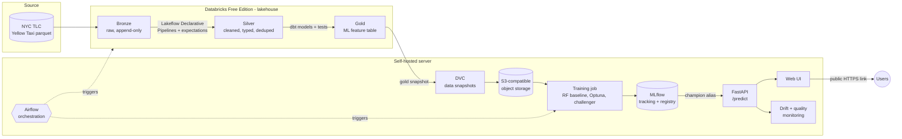
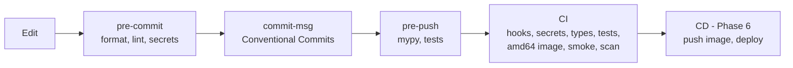

# nyc-taxi-lakehouse-mlops

[](https://github.com/shadmanArko/nyc-taxi-lakehouse-mlops/actions/workflows/ci.yml)


An end-to-end **lakehouse + MLOps** platform that predicts how long a New York City
yellow taxi trip will take, built the way a production data/ML team would build it:
messy public data in, a versioned, tested, monitored model behind a public API out,
every step automated, reviewed and reproducible.

> Built in phases, each one a working, demoable slice. See the [roadmap](#roadmap).

## Architecture



**Design principle: loose coupling through contracts.** No component imports another's
code. They agree only on a **table schema** (gold layer), a **model-registry alias**
(`champion`), and a **versioned API schema** ([`libs/contracts`](libs/contracts)). Any
piece can be rewritten or replaced without touching the others. Details:
[docs/architecture.md](docs/architecture.md).

## Tech stack

| Concern | Tool |
|---|---|
| Lakehouse storage & compute | Databricks Free Edition, Delta Lake, Unity Catalog |
| Ingestion bronze → silver | Lakeflow Declarative Pipelines with data-quality expectations |
| Modeling silver → gold (ELT) | dbt (`dbt-databricks`) with tests and docs |
| Orchestration | Apache Airflow |
| Data versioning | DVC on S3-compatible object storage |
| Training & tuning | scikit-learn `RandomForestRegressor` baseline, Optuna, gradient-boosting challenger |
| Experiment tracking & registry | MLflow |
| Model evaluation gates | Offline metric gates (RMSE vs baseline and vs champion), slice analysis |
| Serving | FastAPI + Pydantic contracts, Docker |
| Monitoring | Data and prediction drift reports |
| Code quality | uv, Ruff, mypy `--strict`, pytest, pre-commit, hadolint, actionlint |
| Security | gitleaks (commit + full history), Grype image scan, dependency review, SHA-pinned actions, Dependabot |
| CI/CD | GitHub Actions (CI now; CD to the server in Phase 6) |
| Exposure | Secure public HTTPS tunnel, no open ports (see [ADR-0004](docs/adr/0004-public-exposure-via-tunnel.md)) |

## Repository layout

```
.
├── libs/contracts/        # versioned schemas shared by all components (the only shared code)
├── services/api/          # FastAPI prediction service + Dockerfile
├── infra/compose/         # local stack (hardened like production)
├── docs/                  # architecture, ADRs, deployment, assignment brief
├── .github/               # CI workflow, Dependabot, PR template
├── databricks/            # Phase 2: Lakeflow pipelines + bundle      (planned)
├── transform/dbt/         # Phase 2: dbt project, silver → gold        (planned)
├── orchestration/airflow/ # Phase 3: DAGs                              (planned)
├── jobs/training/         # Phase 4: training + evaluation job         (planned)
└── services/web/          # Phase 5: end-user UI                       (planned)
```

## Roadmap

- [x] **Phase 1 - Foundation:** monorepo, uv workspace, contracts, API skeleton, hardened container, pre-commit, CI, docs/ADRs
- [ ] **Phase 2 - Data platform:** ingest TLC data, bronze/silver (Lakeflow), gold (dbt), data tests, DVC snapshots
- [ ] **Phase 3 - Orchestration:** Airflow DAGs for the whole flow
- [ ] **Phase 4 - ML:** RF baseline → Optuna → challenger, MLflow tracking, evaluation gate, registry promotion
- [ ] **Phase 5 - Serving + UI:** API serves the `champion` model, web UI, sample request
- [ ] **Phase 6 - CD + deployment:** images to GHCR, deploy to the server, public HTTPS link
- [ ] **Phase 7 - Monitoring + docs:** drift reports, model card, final write-up

## Quickstart

Requires [uv](https://docs.astral.sh/uv/) ≥ 0.13.5 and Docker.

```bash
make setup     # install workspace + dev tools, install git hooks
make check     # what CI runs except the image jobs: hooks, mypy --strict, tests (coverage ≥ 85%)
make image     # build the API image for linux/amd64 (CI's api-image job)
make up        # build and start the local stack
make smoke     # /health -> ok, /ready -> 503 until a model exists (Phase 5)
```

Interactive API docs: <http://127.0.0.1:8000/docs> while the stack is up.

## How work flows



See [CONTRIBUTING.md](CONTRIBUTING.md).

## Assignment

This project started from a course brief: train a `RandomForestRegressor` on January 2025
yellow taxi data, track it with MLflow and serve it with FastAPI. The brief and how each
requirement maps to this repo: [docs/assignment.md](docs/assignment.md).

| Question | Answer |
|---|---|
| RMSE of the final model | _Phase 4_ |
| What would you do differently with more time? | _Phase 7_ |

## License

[MIT](LICENSE)
