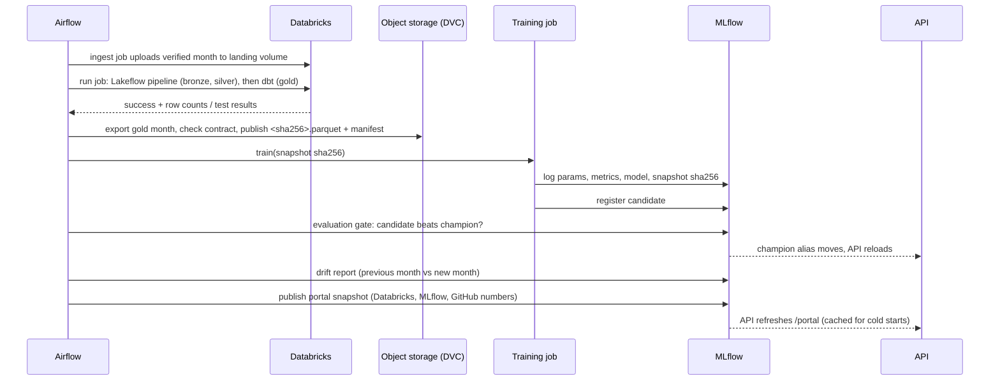

# Architecture

## Goals

1. **Predict trip duration** (minutes) for NYC yellow taxi trips from what is known at pickup.
2. **Show production practice end to end:** reproducible data, tested transforms, tracked
   experiments, gated promotion, a hardened service and automated delivery.
3. **Loose coupling:** every component can be rebuilt, replaced or redeployed on its own.

## Components and where they run

| Component | Runs on | Responsibility | Phase |
|---|---|---|---|
| Lakehouse (bronze/silver/gold) | Databricks Free Edition (serverless) | Land raw TLC data, clean it, build the ML feature table | 2 |
| dbt project | Databricks SQL warehouse, invoked from Airflow / CI | silver → gold models, tests, docs | 2 |
| Object storage | Self-hosted server (S3-compatible) | DVC remote, MLflow artifact store | 2 |
| Airflow | Self-hosted server | Schedule and chain every step, retries, alerting | 3 |
| Training job | Self-hosted server (container) | Train, tune, evaluate, log to MLflow, propose a candidate | 4 |
| MLflow | Self-hosted server | Experiment tracking, model registry, `champion` alias | 4 |
| API | Self-hosted server (container) | Validate requests, serve the champion model | 1 (skeleton), 5 |
| Web UI | Self-hosted server (container) | Form for end users, calls the API | 5 |
| Monitoring job | Self-hosted server (Airflow task) | PSI drift per feature and target, champion RMSE on the new month, retrain advice | 7 |
| BI marts | Databricks SQL warehouse (dbt) | Hourly demand and pace, daily trips, pickup zones | 7 |
| Portal snapshot job | Self-hosted server (Airflow task) | Collect every department's numbers, publish one `portal.json` to MLflow | 7 |
| Portal | Web UI + API `GET /portal` | Overview + one page per department; requirements register; model card | 7 |

Databricks Free Edition cannot reach a private server, and its outbound internet is
limited to an allowlist, so data always crosses the boundary **from our side**: the
ingest job *pushes* raw files into a Unity Catalog landing volume
([ADR-0006](adr/0006-push-ingestion-and-portable-quality-rules.md)), and later the server
*pulls* the gold table through the Databricks SQL connector and snapshots it with DVC
([ADR-0003](adr/0003-hybrid-databricks-and-self-hosted.md)).

## Contracts (the only coupling)

| Producer → consumer | Contract | Where it is defined | Change rule |
|---|---|---|---|
| TLC → lakehouse | Raw file contract `RAW_YELLOW_REQUIRED` (columns by type family) + manifest | [`libs/contracts`](../libs/contracts), `jobs/ingest` | A file that fails it never lands |
| Lakehouse → training | Gold table `<catalog>.taxi_gold.trip_features`, enforced dbt contract = `GOLD_TRIP_FEATURES` | `transform/dbt`, [`libs/contracts`](../libs/contracts) | Additive changes only; a test keeps dbt and Python equal |
| Training → serving | MLflow registered model `taxi-trip-duration`, alias `champion`, pyfunc signature | MLflow (Phase 4) | Promotion only through the evaluation gate |
| Serving → clients | `TripFeatures` / `PredictionResponse` | [`libs/contracts`](../libs/contracts) | Semver: `CONTRACT_VERSION`; breaking = major bump |
| Orchestrator → everything | Container images + CLI entry points | each component's Dockerfile | Images are versioned and pinned |
| Pipeline → portal | `portal.json` (`snapshot_version`), one section per department, each `ok` / `unavailable` | `jobs/portal` ([ADR-0011](adr/0011-portal-monitoring-and-retention.md)) | Additive; bump `snapshot_version` on breaking change |
| Docs → portal | `docs/requirements.yaml`, `docs/model-card.md` (copied into the site) | `tools/build_portal_static.py` | A test fails if copies drift or a trace breaks |

The model is logged **with its preprocessing** (one scikit-learn pipeline), so the API never
re-implements feature engineering. That removes the most common train/serve skew.

## Data flow

## Non-functional requirements

- **Reproducibility:** pinned dependencies (`uv.lock`), pinned images (digest), DVC data
  versions recorded on every MLflow run, fixed random seeds.
- **Security:** no secrets in Git (gitleaks on staged changes locally, full-history scan in
  CI), secrets as files, images scanned for vulnerabilities, containers non-root with all
  capabilities dropped, ports bound to loopback. Public access only through an outbound
  tunnel; only the UI, `/predict` and read-only `/zones`, `/ready`, `/health`, `/portal`
  are public, admin tools stay private.
- **Quality gates:** formatting, lint, strict typing, tests with a coverage floor, a contract
  schema snapshot, data tests (dbt + expectations), model evaluation gate before promotion.
  CI reports one aggregate status (`ci-ok`) for branch protection.
- **Operability:** `/health` (liveness) and `/ready` (readiness) on every service, health
  checks in compose, log rotation, CPU/RAM limits; weekly image retention in GHCR and on
  the server.
- **Traceability:** every functional and non-functional requirement in
  [requirements.yaml](requirements.yaml) points at the code and the test that proves it;
  CI fails if a link breaks.

## Decisions

Recorded as ADRs in [docs/adr](adr/).
