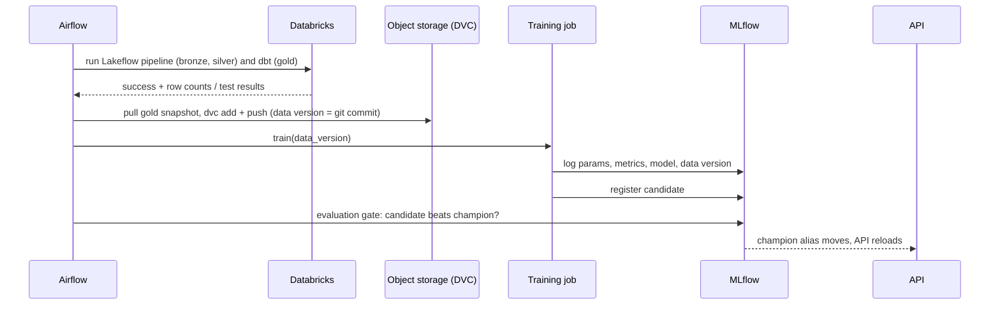

# Architecture

## Goals

1. **Predict trip duration** (minutes) for NYC yellow taxi trips from what is known at pickup.
2. **Show production practice end to end:** reproducible data, tested transforms, tracked
   experiments, gated promotion, a hardened service and automated delivery.
3. **Loose coupling:** every component can be rebuilt, replaced or redeployed on its own.

## Components and where they run

| Component | Runs on | Responsibility | Phase |
|---|---|---|---|
| Lakehouse (bronze/silver/gold) | Databricks Free Edition (serverless) | Land raw TLC data, clean it, build the ML feature table | 2 |
| dbt project | Databricks SQL warehouse, invoked from Airflow / CI | silver → gold models, tests, docs | 2 |
| Object storage | Self-hosted server (S3-compatible) | DVC remote, MLflow artifact store | 2 |
| Airflow | Self-hosted server | Schedule and chain every step, retries, alerting | 3 |
| Training job | Self-hosted server (container) | Train, tune, evaluate, log to MLflow, propose a candidate | 4 |
| MLflow | Self-hosted server | Experiment tracking, model registry, `champion` alias | 4 |
| API | Self-hosted server (container) | Validate requests, serve the champion model | 1 (skeleton), 5 |
| Web UI | Self-hosted server (container) | Form for end users, calls the API | 5 |
| Monitoring | Self-hosted server | Data and prediction drift reports | 7 |

Databricks Free Edition cannot reach a private server, so data crosses the boundary
**outbound from the server**: the server pulls the gold table through the Databricks SQL
connector and snapshots it with DVC. See [ADR-0003](adr/0003-hybrid-databricks-and-self-hosted.md).

## Contracts (the only coupling)

| Producer → consumer | Contract | Where it is defined | Change rule |
|---|---|---|---|
| Lakehouse → training | Gold table `taxi.gold.trip_features` schema + dbt tests | `transform/dbt` (Phase 2) | Additive changes only; breaking change = new table version |
| Training → serving | MLflow registered model `taxi-trip-duration`, alias `champion`, pyfunc signature | MLflow (Phase 4) | Promotion only through the evaluation gate |
| Serving → clients | `TripFeatures` / `PredictionResponse` | [`libs/contracts`](../libs/contracts) | Semver: `CONTRACT_VERSION`; breaking = major bump |
| Orchestrator → everything | Container images + CLI entry points | each component's Dockerfile | Images are versioned and pinned |

The model is logged **with its preprocessing** (one scikit-learn pipeline), so the API never
re-implements feature engineering. That removes the most common train/serve skew.

## Data flow

## Non-functional requirements

- **Reproducibility:** pinned dependencies (`uv.lock`), pinned images (digest), DVC data
  versions recorded on every MLflow run, fixed random seeds.
- **Security:** no secrets in Git (gitleaks on staged changes locally, full-history scan in
  CI), secrets as files, images scanned for vulnerabilities, containers non-root with all
  capabilities dropped, ports bound to loopback. Public access only through an outbound
  tunnel; only the UI and `/predict` are public, admin tools stay private.
- **Quality gates:** formatting, lint, strict typing, tests with a coverage floor, a contract
  schema snapshot, data tests (dbt + expectations), model evaluation gate before promotion.
  CI reports one aggregate status (`ci-ok`) for branch protection.
- **Operability:** `/health` (liveness) and `/ready` (readiness) on every service, health
  checks in compose, log rotation, CPU/RAM limits.

## Decisions

Recorded as ADRs in [docs/adr](adr/).
